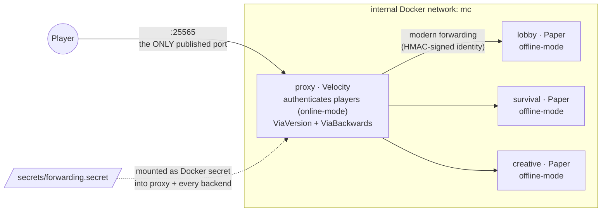

# mc-stack

A small, opinionated **Velocity proxy + Paper backend** Minecraft network,
defined entirely as Docker Compose. Built on the
[itzg](https://github.com/itzg/docker-minecraft-server) images.

Backends run Minecraft **26.1.2** (pinned in `.env`) on Paper / Java 25. Every
image — proxy, backends, and the backup sidecars — is pinned to a specific
verified release; see **Versioning & updates** below.

## Architecture



| Service    | Gamemode  | World     | Memory | Notes                                                                     |
| ---------- | --------- | --------- | ------ | ------------------------------------------------------------------------- |
| `lobby`    | adventure | superflat | 2G     | Peaceful hub, players land here. Startup commands freeze day/weather and disable mob spawning. |
| `survival` | survival  | default   | 4G     | Normal difficulty.                                                        |
| `creative` | creative  | superflat | 4G     | Build space; spawn pinned at 0,0,0.                                       |

### Design rules

- **Only the proxy is exposed.** Backends live on the internal network and publish
  no host ports, so an offline-mode backend can never be reached directly with a
  spoofed username.
- **Backends are offline-mode; the proxy authenticates players** (online-mode) and
  hands verified identities to backends via Velocity **modern forwarding**.
- **One shared forwarding secret** (`secrets/forwarding.secret`) HMAC-signs that
  forwarding, so a backend only trusts player info that came from _this_ proxy.
  Generated once by `make secret`, mounted everywhere as a Docker secret, never
  committed.
- **Automated backups, one sidecar per backend.** An `itzg/mc-backup` sidecar
  (`backup-lobby`/`backup-survival`/`backup-creative`) pauses saves over RCON
  (a second secret, `secrets/rcon.secret`), tars the backend's read-only
  `/data` mount, resumes saves, and prunes old archives — all `.env`-tunable.
- **Operational hardening.** `stop_grace_period: 1m` gives Paper time to flush
  world saves on shutdown; every service's logs are capped (json-file,
  10 MB × 5 files) so long uptimes don't fill the disk.
- **Repo holds structure; sites tune `.env`; runtime state stays out of git.**

## Repository structure

```
.
├── .github/
│   ├── dependabot.yml     # weekly PRs: image tags (docker-compose) + actions
│   └── workflows/
│       └── validate.yml   # CI: `docker compose config` on push/PR
├── compose.yml            # the whole network: shared anchors + per-service overrides
├── .env.example           # all tunables, documented → copied to .env by `make setup`
├── Makefile               # secret / setup / up / down / restart / ps / logs
├── docs/
│   └── operations.md      # backup/restore runbook, update procedure
├── proxy/
│   └── velocity.toml      # proxy config (mounted read-only)
├── paper/
│   └── paper-global.yml   # shared Paper config (mounted read-only into every backend)
├── secrets/
│   ├── forwarding.secret  # shared HMAC secret       (gitignored; `make secret`)
│   └── rcon.secret        # backends' RCON password  (gitignored; `make secret`)
├── backups/
│   └── <lobby|survival|creative>/  # tar archives from the backup sidecars (gitignored)
└── servers/
    └── <lobby|survival|creative>/
        ├── data/          # world, logs, server jar (gitignored)
        └── plugins/       # plugin jars + their configs (gitignored)
```

Config reaches the servers by two routes — committed files are mounted read-only,
values are re-read every time a container is (re)created:

```
.env ──────(compose ${VAR:-default})───▶ container env ──┐
                                                         ├─(itzg boot: sync + ${CFG_*} expansion)─▶ live config
proxy/ + paper/ ──(mounted read-only)──▶ mounted config ─┘
```

## Quick start

```bash
make secret    # generate secrets/{forwarding,rcon}.secret  (run once)
make setup     # create .env from .env.example
$EDITOR .env   # set OPS (your username), TZ, PROXY_MOTD, ...
make up        # docker compose up -d
```

Connect a Minecraft client to `localhost:25565`. In-game, `/server survival`
switches backends (`/server` is built into Velocity).

## Configuration (`.env`)

Everything site-specific is tuned in `.env` — `compose.yml` holds structure and
safe defaults only. After changing `.env`, apply with `docker compose up -d`
(**not** `make restart`: environment changes require the containers to be
recreated).

| Variable                     | Default                                | Purpose                                                                  |
| ---------------------------- | -------------------------------------- | ------------------------------------------------------------------------ |
| `MC_VERSION`                 | `26.1.2`                               | Minecraft version for all backends. 26.1+ needs a `*-java25` backend image tag. |
| `OPS`                        | _(empty)_                              | Comma-separated operator usernames, applied to every backend.            |
| `TZ`                         | `UTC`                                  | Timezone for log timestamps, e.g. `Asia/Tokyo`.                          |
| `PROXY_MOTD`                 | `A Minecraft Server`                   | Server-list MOTD (the proxy's — the only one players see). MiniMessage tags allowed. |
| `LOBBY_MODRINTH_PROJECTS`    | _(empty)_                               | Plugins on **lobby**: comma-separated Modrinth slugs.                    |
| `SURVIVAL_MODRINTH_PROJECTS` | _(empty)_                               | Plugins on **survival**: comma-separated Modrinth slugs.                 |
| `CREATIVE_MODRINTH_PROJECTS` | `fastasyncworldedit,axiom-paper-plugin` | Plugins on **creative**: comma-separated Modrinth slugs.                 |
| `PROXY_MODRINTH_PROJECTS`    | `viaversion,viabackwards`              | Plugins on **the proxy**: comma-separated Modrinth slugs.                |
| `LOBBY_RCON_CMDS_STARTUP`    | _(empty = run nothing)_                | Console commands run each time `lobby` finishes booting.                 |
| `CREATIVE_RCON_CMDS_STARTUP` | _(empty = run nothing)_                | Same for `creative`.                                                     |
| `BACKUP_INTERVAL`            | `24h`                                  | How often each backup sidecar pauses saves and archives `/data`.         |
| `PRUNE_BACKUPS_DAYS`         | `7`                                     | Delete archives under `backups/<name>/` older than this many days.      |

### Startup commands (RCON)

One command per line inside double quotes:

```dotenv
LOBBY_RCON_CMDS_STARTUP="gamerule spawn_mobs false
gamerule advance_time false
time set day"
```

> [!NOTE]
> Since Minecraft 1.21.11, gamerules use snake_case registry names
> (`spawn_mobs`, `advance_time`, `advance_weather`, ...). Old camelCase names
> (`doMobSpawning`, ...) fail **non-fatally** — the server still boots, and the
> only trace is in `docker compose logs <backend> | grep "Rcon loop"`.

## Plugins

Plugins are declared, never committed as jars: itzg downloads them at boot
(matched to the server type and `MC_VERSION`) and **deletes** any plugin whose
entry is removed.

| Layer      | `.env` variable              | Source              | Defaults                                     |
| ---------- | ---------------------------- | ------------------- | -------------------------------------------- |
| proxy      | `PROXY_MODRINTH_PROJECTS`    | Modrinth slugs      | ViaVersion, ViaBackwards                     |
| `lobby`    | `LOBBY_MODRINTH_PROJECTS`    | Modrinth slugs      | _(none)_                                     |
| `survival` | `SURVIVAL_MODRINTH_PROJECTS` | Modrinth slugs      | _(none)_                                     |
| `creative` | `CREATIVE_MODRINTH_PROJECTS` | Modrinth slugs      | FastAsyncWorldEdit, Axiom (serverside half)  |

- **Via\* lives ONLY on the proxy** (protocol translation for older/newer
  clients). Adding it to a backend as well breaks joins with version mismatches.
- **Each backend declares its own list** — building tools (FAWE, Axiom) default
  to creative only; network-wide plugins are simply listed on every backend.
- Axiom multiplayer use requires a commercial license or a whitelist from the
  Axiom Discord; players also need the Axiom client mod and op permission.

## Backups

Each backend has a paired `itzg/mc-backup` sidecar (`backup-lobby`,
`backup-survival`, `backup-creative`): every `BACKUP_INTERVAL` it pauses world
saves over RCON, tars the backend's read-only `/data` mount into
`backups/<name>/`, then resumes saves. Archives older than
`PRUNE_BACKUPS_DAYS` are pruned automatically. A backup also runs a couple of
minutes after every `docker compose up`, on top of the interval.

Trigger one on demand:

```bash
docker compose exec backup-lobby backup now
```

Tune both knobs in `.env` (`BACKUP_INTERVAL`, `PRUNE_BACKUPS_DAYS`). For the
restore procedure, see [`docs/operations.md`](docs/operations.md).

## Versioning & updates

Every image is pinned to a specific verified release —
`itzg/minecraft-server:2026.7.0-java25` (backends), `itzg/mc-proxy:2025.10.0-java25`
(proxy), `itzg/mc-backup:2026.6.2` (backup sidecars) — plus
`VELOCITY_VERSION: "3.5.0-SNAPSHOT"` (the finest pin itzg exposes; the build
within that version string still floats).

[Dependabot](.github/dependabot.yml) opens weekly PRs bumping those image tags
and GitHub Actions; CI ([`.github/workflows/validate.yml`](.github/workflows/validate.yml))
runs `docker compose config` on every push to `main` and every PR. `MC_VERSION`
(the actual Minecraft version, in `.env`) is a separate, manual, coupled bump —
change it together with the backend image's `-javaNN` variant (26.1+ needs
`java25`; only drop to `java21` when pinning a 1.21.x version).

## Add a server

1. Copy a backend block in `compose.yml` (e.g. `survival:`) under a new name,
   with its own `./servers/<name>/data:/data` and
   `./servers/<name>/plugins:/data/plugins` mounts and its own
   `<NAME>_MODRINTH_PROJECTS` variable. The shared `./paper/paper-global.yml`
   mount is reused as-is; `/data` is created on first run.
2. Add `<name> = "<name>:25565"` under `[servers]` in `proxy/velocity.toml`.
3. `make up`.

## Troubleshooting

| Symptom                                     | Check                                                                                                                            |
| ------------------------------------------- | -------------------------------------------------------------------------------------------------------------------------------- |
| Backend kicks forwarded players             | Proxy and backend secrets differ — inspect what Paper actually loaded: `docker compose exec lobby grep secret /data/config/paper-global.yml` |
| Startup commands silently not applied       | `docker compose logs <backend> \| grep "Rcon loop"` — failed commands are non-fatal; see the gamerule naming note above.          |
| `.env` change has no effect                 | Environment changes need `docker compose up -d` (recreate), not `make restart`.                                                   |
| Backups not appearing under `backups/<name>/` | `docker compose logs backup-<name>` — RCON auth/secret issues show there.                                                       |
| Compose YAML / anchor doubts                | `docker compose config` renders the merged result without starting anything.                                                      |
