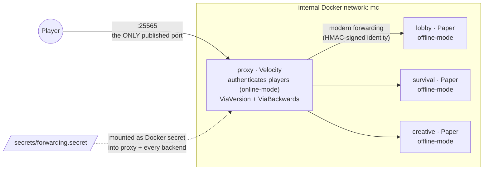

# mc-stack

A small, opinionated **Velocity proxy + Paper backend** Minecraft network,
defined entirely as Docker Compose. Built on the
[itzg](https://github.com/itzg/docker-minecraft-server) images.

Backends run Minecraft **26.1.2** (pinned in `.env`) on Paper / Java 25;
Velocity tracks its latest build.

## Architecture



| Service    | Gamemode  | World     | Memory | Notes                                                                     |
| ---------- | --------- | --------- | ------ | ------------------------------------------------------------------------- |
| `lobby`    | adventure | superflat | 2G     | Peaceful hub, players land here. Startup commands freeze day/weather and disable mob spawning. |
| `survival` | survival  | default   | 4G     | Normal difficulty.                                                        |
| `creative` | creative  | superflat | 4G     | Build space; spawn pinned at 0,0,0.                                       |

### Design rules

- **Only the proxy is exposed.** Backends live on the internal network and publish
  no host ports, so an offline-mode backend can never be reached directly with a
  spoofed username.
- **Backends are offline-mode; the proxy authenticates players** (online-mode) and
  hands verified identities to backends via Velocity **modern forwarding**.
- **One shared forwarding secret** (`secrets/forwarding.secret`) HMAC-signs that
  forwarding, so a backend only trusts player info that came from _this_ proxy.
  Generated once by `make secret`, mounted everywhere as a Docker secret, never
  committed.
- **Repo holds structure; sites tune `.env`; runtime state stays out of git.**

## Repository structure

```
.
├── compose.yml            # the whole network: shared anchors + per-service overrides
├── .env.example           # all tunables, documented → copied to .env by `make setup`
├── Makefile               # secret / setup / up / down / restart / ps / logs
├── proxy/
│   └── velocity.toml      # proxy config template (mounted read-only)
├── secrets/
│   └── forwarding.secret  # shared HMAC secret   (gitignored; `make secret`)
└── servers/
    └── <lobby|survival|creative>/
        ├── config/
        │   ├── paper-global.yml.example  # committed template
        │   └── paper-global.yml          # live copy    (gitignored; `make setup`)
        └── data/                         # world, plugins, logs (gitignored)
```

Config reaches the servers by two routes — templates are copied once, values are
re-read every time a container is (re)created:

```
.env ────(compose ${VAR:-default})────▶ container env ──┐
                                                        ├─(itzg boot: sync + ${CFG_*} expansion)─▶ live config
*.example ──(make setup, copy once)──▶ mounted config ──┘
```

## Quick start

```bash
make secret    # generate secrets/forwarding.secret  (run once)
make setup     # create live config + .env from templates
$EDITOR .env   # set OPS (your username), TZ, PROXY_MOTD, ...
make up        # docker compose up -d
```

Connect a Minecraft client to `localhost:25565`. In-game, `/server survival`
switches backends (`/server` is built into Velocity).

## Configuration (`.env`)

Everything site-specific is tuned in `.env` — `compose.yml` holds structure and
safe defaults only. After changing `.env`, apply with `docker compose up -d`
(**not** `make restart`: environment changes require the containers to be
recreated).

| Variable                     | Default                                | Purpose                                                                  |
| ---------------------------- | -------------------------------------- | ------------------------------------------------------------------------ |
| `MC_VERSION`                 | `26.1.2`                               | Minecraft version for all backends. 26.1+ needs the `java25` image tag.  |
| `OPS`                        | _(empty)_                              | Comma-separated operator usernames, applied to every backend.            |
| `TZ`                         | `UTC`                                  | Timezone for log timestamps, e.g. `Asia/Tokyo`.                          |
| `PROXY_MOTD`                 | `A Minecraft Server`                   | Server-list MOTD (the proxy's — the only one players see). MiniMessage tags allowed. |
| `PAPER_MODRINTH_PROJECTS`    | `fastasyncworldedit,axiom-paper-plugin` | Plugins on **every backend**: comma-separated Modrinth slugs.            |
| `PROXY_SPIGET_PLUGINS`       | `19254,27448`                          | Plugins on **the proxy**: comma-separated Spiget resource IDs.           |
| `LOBBY_RCON_CMDS_STARTUP`    | _(empty = run nothing)_                | Console commands run each time `lobby` finishes booting.                 |
| `CREATIVE_RCON_CMDS_STARTUP` | _(empty = run nothing)_                | Same for `creative`.                                                     |

### Startup commands (RCON)

One command per line inside double quotes:

```dotenv
LOBBY_RCON_CMDS_STARTUP="gamerule spawn_mobs false
gamerule advance_time false
time set day"
```

> [!NOTE]
> Since Minecraft 1.21.11, gamerules use snake_case registry names
> (`spawn_mobs`, `advance_time`, `advance_weather`, ...). Old camelCase names
> (`doMobSpawning`, ...) fail **non-fatally** — the server still boots, and the
> only trace is in `docker compose logs <backend> | grep "Rcon loop"`.

## Plugins

Plugins are declared, never committed as jars: itzg downloads them at boot
(matched to the server type and `MC_VERSION`) and **deletes** any plugin whose
entry is removed.

| Layer         | `.env` variable           | Source              | Defaults                                       |
| ------------- | ------------------------- | ------------------- | ---------------------------------------------- |
| proxy         | `PROXY_SPIGET_PLUGINS`    | Spiget resource IDs | ViaVersion (`19254`), ViaBackwards (`27448`)   |
| every backend | `PAPER_MODRINTH_PROJECTS` | Modrinth slugs      | FastAsyncWorldEdit, Axiom (serverside half)    |

- **Via\* lives ONLY on the proxy** (protocol translation for older/newer
  clients). Adding it to a backend as well breaks joins with version mismatches.
- Axiom multiplayer use requires a commercial license or a whitelist from the
  Axiom Discord; players also need the Axiom client mod and op permission.

## Add a server

1. Copy a backend block in `compose.yml` (e.g. `survival:`) under a new name,
   with its own `./servers/<name>/data:/data` mount.
2. Create `servers/<name>/config/paper-global.yml.example` (copy an existing
   one) so `make setup` can materialize it; `/data` is created on first run.
3. Add `<name> = "<name>:25565"` under `[servers]` in `proxy/velocity.toml`.
4. `make setup && make up`.

## Troubleshooting

| Symptom                                     | Check                                                                                                                            |
| ------------------------------------------- | -------------------------------------------------------------------------------------------------------------------------------- |
| Backend kicks forwarded players             | Proxy and backend secrets differ — inspect what Paper actually loaded: `docker compose exec lobby grep secret /data/config/paper-global.yml` |
| Startup commands silently not applied       | `docker compose logs <backend> \| grep "Rcon loop"` — failed commands are non-fatal; see the gamerule naming note above.          |
| `.env` change has no effect                 | Environment changes need `docker compose up -d` (recreate), not `make restart`.                                                   |
| Compose YAML / anchor doubts                | `docker compose config` renders the merged result without starting anything.                                                      |
